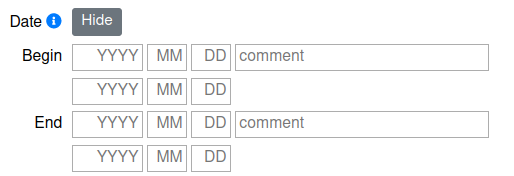
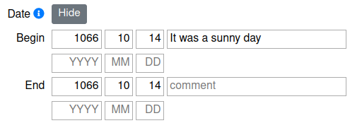
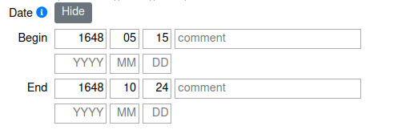
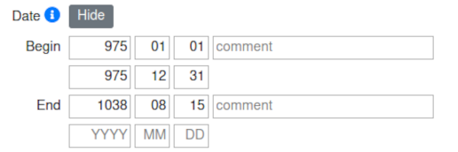
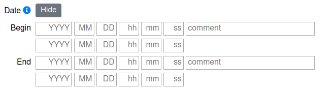

Time Spans
==========

.. toctree::

This section is focused on how the :doc:`Date</ui/date>` input fields work
and how to enter time spans correctly.

Where to find the input fields
------------------------------

:doc:`Date</ui/date>` input fields can be found on the following forms:

* All forms connected to :doc:`Events</entity/event>`
* All forms connected to :doc:`Actors</entity/actor>`
* All forms connected to :doc:`Types</entity/type>`
* :doc:`Places</entity/place>`
* :doc:`Features</entity/feature>`
* :doc:`Stratigraphic Units</entity/stratigraphic_unit>`
* :doc:`Artifacts </entity/item>`

It is not provided for the input of:

* :doc:`Sources</entity/source>`
* :doc:`References</entity/reference>`

The **Date** field is at the bottom of the form and is initially hidden. Click
**Show** to open it and **Hide** to close it. It opens automatically when dates
are already present or when a date error needs attention.

How to enter dates and time spans
---------------------------------

The current form has two views. **Simple** provides one date for **Begin** and
one for **End**. **Advanced** provides two bounds for each date:

* **Begin — Earliest / Latest** bounds the uncertain date on which the event
  began.
* **End — Earliest / Latest** bounds the uncertain date on which it ended.

The screenshots in this section show the earlier four-row layout. The current
form labels those rows **Earliest** and **Latest** in the **Advanced** view; the
screenshots are retained unchanged.

Each pair describes uncertainty in that particular date, not the duration of a
process between the two bounds. A single bound can be left open when its limit
is unknown. The detailed form behavior is described in :doc:`Date</ui/date>`.

**Input values**

* **Year**: -4713 to 9999, except 0. Use a minus sign for BC dates; for example,
  -1 is 1 BC.
* **Month**: 1 to 12.
* **Day**: 1 to 31, subject to the valid number of days in that month and year.
* **Comment**: free text for additional information about the Begin or End date.

The `YYYY`, `MM` and `DD` placeholders do not require four- or two-digit input;
leading zeroes are optional. A year is required for every populated bound, and
a month is required when entering a day. Dates are validated against the
`Proleptic Gregorian calendar <https://en.wikipedia.org/wiki/Proleptic_Gregorian_calendar>`_,
including leap years; year 0 does not exist and dates before 4713 BC cannot be
recorded.

Precise dates
^^^^^^^^^^^^^

For an exact calendar day, enter the full date in **Simple**. For the Battle of
Hastings, enter **1066-10-14** as both **Begin** and **End**. A date without a
specific time represents the whole day, not one instant.

In **Advanced**, enter that same date in both bounds of each exact date: put
**1066-10-14** in **Begin Earliest** and **Begin Latest**, and in **End
Earliest** and **End Latest**. A date entered in only one Advanced bound is an
open earliest or latest limit, not an exact date.

The Peace of Westphalia refers to two peace treaties, signed in Osnabrück on
**1648-05-15** and in Münster on **1648-10-24**. In **Simple**, enter
**1648-05-15** as **Begin** and **1648-10-24** as **End**. In **Advanced**,
enter each date in both bounds of its pair: **Begin Earliest** and **Begin
Latest** for **1648-05-15**, then **End Earliest** and **End Latest** for
**1648-10-24**.

Uncertain dates and ranges
^^^^^^^^^^^^^^^^^^^^^^^^^^

Use **Advanced** when the date of the beginning, the date of the end, or both
are uncertain. The four bounds are:

* **Begin Earliest**: earliest possible date on which the event began.
* **Begin Latest**: latest possible date on which it began.
* **End Earliest**: earliest possible date on which it ended.
* **End Latest**: latest possible date on which it ended.

An **Earliest** value is completed toward the start of its precision: for
example, year **800** becomes **800-01-01**, and month **800-05** becomes
**800-05-01**. A **Latest** value is completed toward the end: year **800**
becomes **800-12-31**, and month **800-05** becomes **800-05-31**. If all time
fields are blank, the corresponding time is **00:00:00** for **Earliest** and
**23:59:59** for **Latest**. The bounds are inclusive.

For example, entering **800** as **Simple Begin** gives a beginning date
anywhere in that year, from **800-01-01** through **800-12-31**. Entering
**800-05** gives the whole month. In **Advanced**, entering **800** only in
**Begin Earliest** sets a lower bound of **800-01-01** and leaves the latest
bound unknown; it does not represent the whole year. To record a beginning date
known to fall between **1800** and **1809**, enter **1800** in **Begin
Earliest** and **1809** in **Begin Latest**.

King Stephen I of Hungary was born at an unknown time in **975** and died on
**1038-08-15**. In **Simple**, enter **975** as **Begin** and **1038-08-15** as
**End**. In **Advanced**, enter **975** in both **Begin Earliest** and **Begin
Latest** to express the birth-year interval. For the exact death day, enter
**1038-08-15** in both **End Earliest** and **End Latest**; filling only
**End Earliest** would instead leave the latest end date unknown.

One-sided bounds
^^^^^^^^^^^^^^^^

When only the **Latest** bound is known, leave **Earliest** empty. For example,
if a charter records that a church was consecrated on **1150-06-15**, enter that
date in **Begin Latest** and leave **Begin Earliest** empty. The beginning is
known to have occurred by that date at the latest; its earliest limit is
unknown. The displayed value uses **by …**.

Similarly, if an itinerary dated **1220-10-04** says a church had already been
destroyed or was no longer standing, enter that date in **End Latest** and
leave **End Earliest** empty. This means the end occurred by **1220-10-04** at
the latest; it does not assert how long a destruction process lasted.

The inverse is also possible. If a source establishes that a beginning date
was no earlier than **1150-06-15**, enter it in **Begin Earliest** and leave
**Begin Latest** empty. The displayed value uses **from …**; the latest limit
remains unknown. **End Earliest** can be used in the same way when only a lower
bound for the ending date is known. When both bounds are present, the display
shows **between … and …**. If both bounds describe the same full calendar day
without different custom times, the display shows a single date.

Activate hours, minutes, and seconds
------------------------------------

Time fields are available in **Advanced** when the **Time** module is enabled
in your :doc:`profile</tools/profile>` or when the entity already has date
values that require time fields. To enable the module, click the **gear**, open
**Profile**, choose **Modules**, click **Edit**, and select **Time**. You may
need to refresh the form afterwards. The time fields do not appear in **Simple**.

Hour values range from 0 to 23; minutes and seconds range from 0 to 59. A
minute requires an hour, and a second requires a minute. If all time fields are
left empty, **Earliest** uses **00:00:00** and **Latest** uses **23:59:59**.
For a particular time, enter all three components rather than relying on
partially completed time fields.

