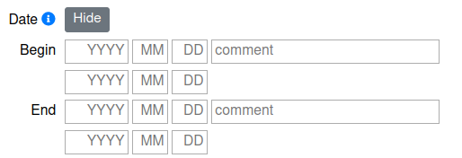

:orphan:

Date
====

.. toctree::

CIDOC based OpenAtlas shortcuts: OA8 (begins in) and OA9 (ends in)

Date fields are initially hidden. Click **Show** next to the **Date** label to
open them; click **Hide** to close them again. If an entity already has dates
or the form contains a date error, the date section opens automatically. The
form also selects **Advanced** when the stored dates cannot be represented by
the simple fields or when there is a date error.

There are two date-entry views:

The screenshot shows the earlier four-row layout. In the current form, choose
between **Simple** and **Advanced** after opening the date fields.

**Simple and Advanced views**

In **Simple**, enter one date for **Begin** and one for **End**. In
**Advanced**, each of those dates has two independent bounds:

* **Begin — Earliest / Latest** bounds the uncertain date on which an event
  began.
* **End — Earliest / Latest** bounds the uncertain date on which it ended.

These are bounds for the beginning and ending dates, not a way to say that a
process (such as destruction) lasted for the entire interval. Either bound may
be left empty when that limit is unknown. Find detailed examples here:
:doc:`/examples/time_spans`.

**Simple dates and precision**

In **Simple**, an entered date represents the whole period at that precision;
the system fills both bounds for the date:

* Entering year **800** gives **800-01-01** through **800-12-31**.
* Entering year **800** and month **05** gives **800-05-01** through
  **800-05-31**.
* Entering **800-05-17** gives that whole calendar day.

Thus, entering a year or month in **Simple** does create a full year or month
interval for that Begin or End date.

To record an exact calendar day, enter the full date in **Simple**. In
**Advanced**, enter the same full date in both bounds of the relevant pair—for
example, in both **Begin Earliest** and **Begin Latest** for an exact beginning
date. A date without a specific time covers the whole day, not a single
instant. For a birth date, for example, enter **1356-12-23** as the Begin date
in **Simple**.

**Advanced bounds and open dates**

In **Advanced**, each bound is completed only toward its own side. An
**Earliest** value is completed to the earliest day at that precision (for
example, year **800** becomes **800-01-01**); a **Latest** value is completed
to the latest day (year **800** becomes **800-12-31**). The opposite bound
remains empty unless you enter it. Therefore, a single **Begin Earliest** value
of **800** is an open lower bound, not a date covering the whole year. Enter
**800** in both **Begin Earliest** and **Begin Latest** to bound the beginning
date to that year. By contrast, entering **800** in the **Simple Begin** field
sets both bounds for the whole year automatically.

Either side can be open:

* **Latest only** gives an upper limit: for example, **Begin Latest** means
  the beginning occurred by that date at the latest; **End Latest** means the
  ending occurred by then. The displayed date uses **by …**.
* **Earliest only** gives a lower limit: for example, **Begin Earliest** means
  the beginning occurred on or after that date; **End Earliest** means the
  ending occurred on or after then. The displayed date uses **from …**.
* With both bounds set, the display gives the date or interval (for example,
  **between … and …**). Both limits are inclusive.

If an Advanced date cannot be represented by a single Simple date, switching
to **Simple** does not discard it. The corresponding Simple date fields are
disabled and a message offers **Edit in advanced view**; return to **Advanced**
to edit the stored bounds.

The preview below each date pair updates as you enter values. It shows the
interpreted date, full year or month, open bound, or interval, and reports
invalid dates or ordering errors. Invalid fields are highlighted, and an
invalid date prevents the form from being submitted.

**Input values and validation**

* **Year**: -4713 to 9999, but not zero. Negative years represent BC dates;
  there is no year zero.
* **Month**: 1 to 12.
* **Day**: 1 to 31, subject to the valid number of days in the selected month
  and year (including leap years).
* **Comment**: add additional information for the Begin or End date.

The `YYYY`, `MM` and `DD` placeholders illustrate the date parts; they do not
require four- or two-digit input. A year is required for every populated date
bound, and a month is required when entering a day. If time fields are
available, a minute requires an hour and a second requires a minute. The
earliest bound must not be later than its corresponding latest bound, and the
Begin date must not be later than the End date.

**Time fields**

Hour, minute and second fields appear in **Advanced** when the time module is
activated in the :doc:`/tools/profile` or when time information already exists
for the entity. Empty time fields are completed according to the bound: an
**Earliest** bound fills omitted parts with **00** (defaulting to
**00:00:00**, **12:00:00** for hour **12**, or **12:30:00** for **12:30**),
while a **Latest** bound fills an omitted hour with **23** and omitted minutes
and seconds with **59** (defaulting to **23:59:59**, **12:59:59** for hour
**12**, or **12:30:59** for **12:30**).

**Background**

Dates are validated, including calendar validity and leap years. The system
uses the `Proleptic Gregorian calendar <https://en.wikipedia.org/wiki/Proleptic_Gregorian_calendar>`_.
There is no year zero: one year before year 1 is year 1 BC. Dates before
4713 BC cannot be recorded.
